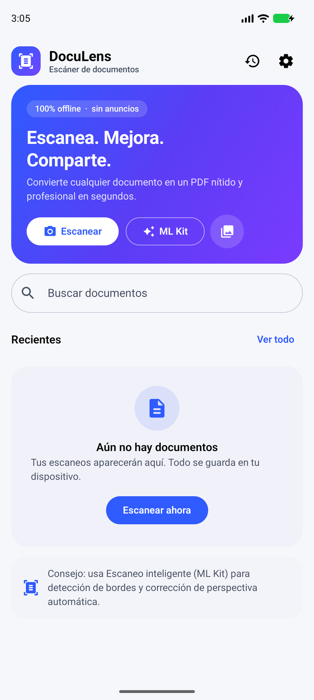
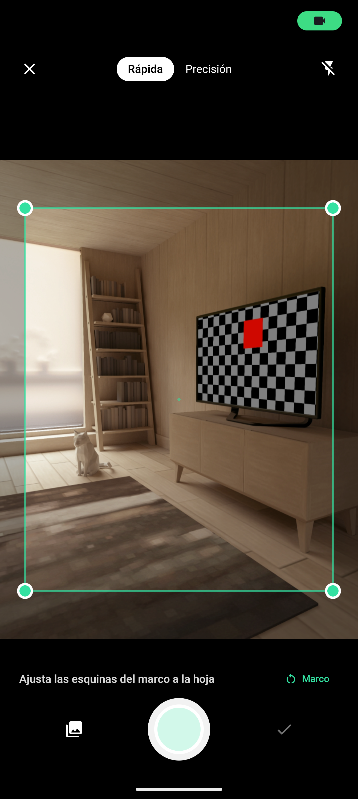
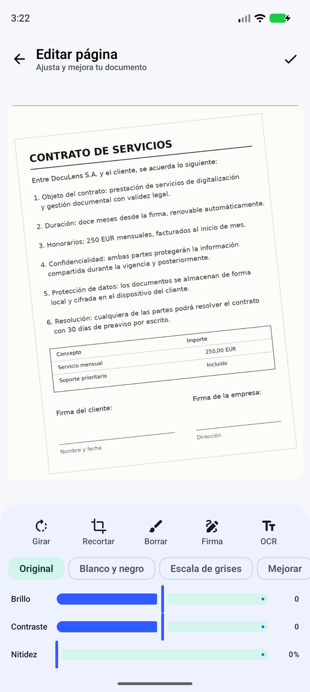
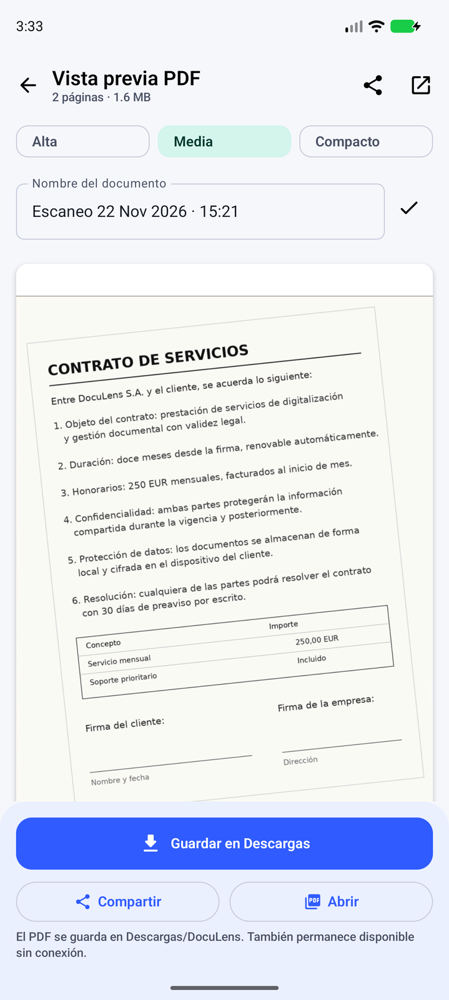

# DocuLens — Escáner de documentos

Aplicación Android nativa para escanear documentos, mejorarlos y generar PDF multipágina. Está construida desde cero con **Kotlin + Jetpack Compose + Material 3**, funciona principalmente **offline**, no incluye anuncios ni rastreo y guarda todo en el almacenamiento del dispositivo.

**Descargar APK:** [GitHub Releases](https://github.com/MAFY284/DocuLens/releases/latest) — `DocuLens-1.0.1-release.apk` firmado.

SHA-256 del APK: `6dc1315152926e85578a220fe6c84e91369b23c808ee871660c37571a44db6a1`






## Características

### Captura
- Cámara CameraX con vista previa del encuadre completo y marco de captura ajustable (4 esquinas arrastrables).
- Recorte exacto al marco y corrección de perspectiva al capturar con el modo Rápida; el marco visible coincide con el área recortada.
- **ML Kit Document Scanner** para detección de bordes, recorte y corrección de perspectiva automática de alta calidad.
- Modo **Rápida** (CameraX + marco manual) y modo **Precisión** (ML Kit).
- Importación desde galería con auto-recorte heurístico y corrección EXIF.
- Flash apagado / automático / encendido.
- Captura de varias páginas en una sola sesión y modo lote.
- Importación desde galería (una o varias imágenes), con rotación EXIF corregida.
- Detección automática del tipo de documento (A4, recibo, tarjeta, foto).

### Edición
- Recorte manual con 4 vértices arrastrables y transformación de perspectiva.
- Rotación en pasos de 90°.
- Filtros: Original, Blanco y negro (umbral adaptativo), Escala de grises, Mejorar (auto-niveles por canal), Alto contraste y Documento limpio (corrección de iluminación/sombras).
- Ajustes de brillo, contraste y nitidez con vista previa en tiempo real.
- Borrador de manchas y sombras con trazos y deshacer.
- Firma dibujada a mano, colocable y redimensionable.
- OCR en el dispositivo con ML Kit Text Recognition (copiar texto).
- Reordenar páginas arrastrando el asa (gesto dedicado) o con “Mover arriba/abajo”.
- Duplicar, eliminar y girar páginas.
- Miniaturas actualizadas tras cada edición.

### PDF y documentos
- PDF multipágina con tamaño A4 y orientación automática.
- Calidad Alta / Media / Compacto (tamaño vs. calidad).
- Vista previa del PDF renderizada antes de guardar.
- Renombrar el documento y regenerar el PDF.
- Guardar en **Descargas/DocuLens** mediante MediaStore (Scoped Storage).
- Compartir con WhatsApp, Gmail, Drive, etc. vía FileProvider.
- Abrir el PDF con cualquier visor instalado.
- Historial de documentos, búsqueda por nombre y eliminación.
- Añadir más páginas a un documento ya creado y regenerar el PDF.

### Experiencia
- Jetpack Compose + Material Design 3, tema claro/oscuro/sistema.
- Animaciones suaves, feedback de progreso y confirmaciones.
- Arquitectura MVVM con estado persistente ante rotación.
- Todo el procesamiento pesado en hilos de fondo; bitmaps acotados para evitar OOM.

## Arquitectura

```
app/src/main/kotlin/com/doculens/app/
├── MainActivity.kt
├── DocuLensApplication.kt
├── data/
│   ├── model/ScannedDocument.kt
│   └── repository/DocumentRepository.kt
├── di/ServiceLocator.kt
├── domain/Models.kt
├── ui/
│   ├── DocuLensRoot.kt
│   ├── Screen.kt
│   ├── components/
│   ├── screens/ (Home, History, Scanner, Edit, Document, PdfPreview, Settings)
│   ├── theme/
│   └── viewmodel/ (AppViewModel, EditorState)
└── utils/
    ├── ImageProcessor.kt
    ├── QuadDetector.kt
    ├── PdfGenerator.kt
    ├── FileHelper.kt
    ├── OcrProcessor.kt
    └── DocumentTypeDetector.kt
```

- **UI**: Compose, navegación propia con pila en `AppViewModel` para conservar estado al rotar.
- **Dominio/modelo**: documentos, páginas, filtros, calidad PDF y quads normalizados.
- **Datos**: repositorio local basado en carpetas + `meta.json` (sin base de datos para mantener el APK ligero y el arranque rápido).
- **Procesamiento**: operaciones de píxeles en Kotlin puro, con manejo de memoria y sin dependencias nativas adicionales.

## Librerías principales

| Librería | Uso |
|---|---|
| Jetpack Compose BOM 2025.06.01 + Material 3 | Interfaz |
| CameraX 1.4.2 | Vista previa, captura y análisis en vivo |
| ML Kit Document Scanner 16.0.0 | Detección de bordes, perspectiva y escaneo guiado |
| ML Kit Text Recognition 16.0.1 | OCR en el dispositivo |
| AndroidX Activity / Lifecycle / Core | Permisos, ciclo de vida, ViewModel |
| ExifInterface | Orientación de fotos |
| Coil 2.7.0 | Miniaturas |
| Kotlin Coroutines 1.10.2 | Procesamiento asíncrono |
| PdfDocument nativo | Generación y PdfRenderer para la vista previa |

OpenCV no se incluye: ML Kit cubre la detección/perspectiva de alta calidad y los filtros utilizan procesamiento de píxeles en Kotlin, lo que reduce el tamaño del APK y evita problemas de compatibilidad en gama media.

## Requisitos

- Android Studio (versión reciente; el proyecto usa AGP 8.13.2).
- JDK 17.
- Android SDK 35 (compileSdk/targetSdk 35).
- Dispositivo Android 8.0+ (minSdk 26).
- Para el escáner ML Kit: Google Play Services. La primera vez puede descargar el módulo de escaneo; después funciona offline.

## Compilar

```bash
# Desde la raíz del proyecto
export JAVA_HOME=/ruta/a/jdk-17
export ANDROID_HOME=/ruta/a/Android/Sdk
./gradlew :app:assembleDebug
```

El APK de depuración queda en:

```
app/build/outputs/apk/debug/app-debug.apk
```

También puedes abrir la carpeta directamente en Android Studio y ejecutar la configuración `app`.

## Generar APK release firmado

El APK publicado en GitHub Releases ya está firmado y listo para instalar. El keystore y `keystore.properties` **no se publican** en el repositorio.

Para compilar tu propio release firmado, crea un keystore y un archivo `keystore.properties` en la raíz:

```bash
keytool -genkeypair -v -keystore keystore/mi-release.jks \
  -alias mialias -keyalg RSA -keysize 2048 -validity 10000
```

```properties
storeFile=keystore/mi-release.jks
storePassword=TU_CONTRASEÑA
keyAlias=mialias
keyPassword=TU_CONTRASEÑA
```

Compilar:

```bash
./gradlew :app:assembleRelease
```

Salida:

```
app/build/outputs/apk/release/app-release.apk
```

Verificar la firma:

```bash
$ANDROID_HOME/build-tools/35.0.0/apksigner verify --print-certs \
  app/build/outputs/apk/release/app-release.apk
```

Guarda el keystore y las contraseñas de forma segura. Nunca subas `keystore.properties` ni el archivo `.jks` al repositorio.

## Instalar

```bash
adb install -r app/build/outputs/apk/release/app-release.apk
```

O copia el APK al dispositivo y ábrelo permitiendo instalación desde orígenes desconocidos.

## Flujo de uso

1. **Inicio** → “Escanear” (CameraX), “ML Kit” (escaneo guiado) o galería.
2. Captura varias páginas; cada captura se recorta y corrige automáticamente.
3. Pulsa el check para abrir el documento.
4. Toca una página para editarla: recorta, gira, filtra, ajusta, borra, firma u obtén OCR.
5. Reordena con el asa de arrastre o el menú de la página; duplica o elimina.
6. Pulsa **Vista previa y PDF**, elige calidad, revisa las páginas y guarda/comparte.
7. Los documentos permanecen en **Historial**, con búsqueda por nombre.

## Almacenamiento y permisos

- Imágenes y metadatos: `filesDir/documents/<id>/`.
- PDF interno: `filesDir/documents/<id>/<nombre>.pdf`.
- Copia para el usuario: `Descargas/DocuLens/<nombre>.pdf` (MediaStore en Android 10+).
- Permisos: `CAMERA`; `WRITE_EXTERNAL_STORAGE` solo hasta Android 9 para guardar en Descargas.
- No se solicita acceso general a archivos ni se sube información a servidores propios.

## Notas y limitaciones

- El escáner ML Kit requiere Google Play Services y puede descargar su módulo la primera vez. El modo **Rápida** y el OCR funcionan sin ese módulo.
- La protección del PDF con contraseña y el widget de acceso rápido no se incluyen en esta versión.
- El modo Rápida usa un marco manual ajustable: alinea las 4 esquinas con la hoja y la captura se recorta exactamente a ese marco. Para detección automática usa el modo Precisión (ML Kit).
- La importación desde galería usa auto-recorte heurístico; si falla, la página se puede recortar manualmente en el editor.
- Los cambios de edición se confirman con el check; al salir con cambios sin guardar se pide confirmación.
- Probado en emulador Android 17 (API 37) y en dispositivo físico Android 16 (API 36).
- Verificado: captura CameraX con marco ajustable y recorte exacto, escáner ML Kit, importación de galería, filtros, OCR, firma, recorte manual, rotación, reordenación por arrastre, PDF A4 multipágina, guardado en Descargas y compartir.

## Licencia

Proyecto de ejemplo de uso personal. Las librerías de Google (ML Kit, CameraX, Play Services) se rigen por sus propias licencias.
